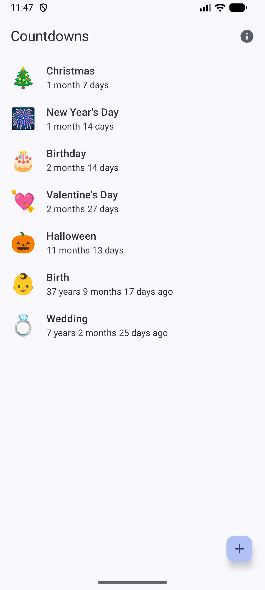
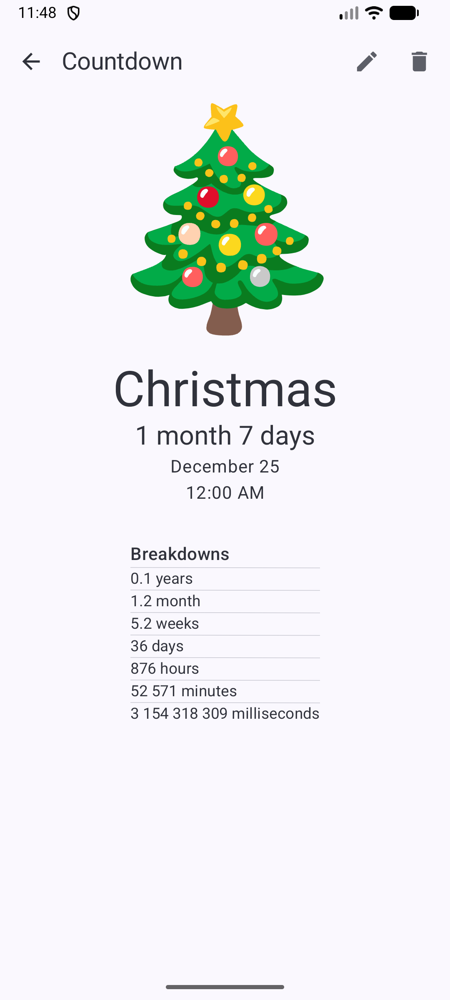

# Countdown

An Android app for keeping track of the time between now and the events you are
looking forward to: a trip, a birthday, a move, a retirement. Give each one an
emoji, a date and an optional title, and the app counts down to it. Once the day
passes, it keeps counting, so you can see how long ago it was.

<p align="center">
  
  
  <br>
  <em>The list, and one countdown opened.</em>
</p>

<p align="center">
  
  
  <a href="LICENSE"></a>
</p>

The app began in 2022 as a small Jetpack Compose experiment for counting down to
a new house, and was generalized in 2025 into something that can track anything.
It stores everything on the device and asks for no permissions, so there is
nothing to sign into and nothing to sync.

## Downloads

The easiest way to get Countdown is by grabbing the latest release directly from
GitHub or by adding it to Obtainium.

<div align="center">
  <a href="https://github.com/JustinMichaudOuellette/Countdown/releases/latest"></a>
  <a href="https://apps.obtainium.imranr.dev/redirect?r=obtainium://app/%7B%22id%22%3A%22ca.justinmo.countdown%22%2C%22url%22%3A%22https%3A%2F%2Fgithub.com%2FJustinMichaudOuellette%2FCountdown%22%2C%22author%22%3A%22JustinMichaudOuellette%22%2C%22name%22%3A%22Countdown%22%2C%22preferredApkIndex%22%3A0%2C%22additionalSettings%22%3A%22%7B%5C%22includePrereleases%5C%22%3Atrue%2C%5C%22fallbackToOlderReleases%5C%22%3Atrue%2C%5C%22filterReleaseTitlesByRegEx%5C%22%3A%5C%22%5C%22%2C%5C%22filterReleaseNotesByRegEx%5C%22%3A%5C%22%5C%22%2C%5C%22verifyLatestTag%5C%22%3Afalse%2C%5C%22sortMethodChoice%5C%22%3A%5C%22date%5C%22%2C%5C%22useLatestAssetDateAsReleaseDate%5C%22%3Afalse%2C%5C%22releaseTitleAsVersion%5C%22%3Afalse%2C%5C%22trackOnly%5C%22%3Afalse%2C%5C%22versionExtractionRegEx%5C%22%3A%5C%22%5C%22%2C%5C%22matchGroupToUse%5C%22%3A%5C%22%5C%22%2C%5C%22versionDetection%5C%22%3Atrue%2C%5C%22releaseDateAsVersion%5C%22%3Afalse%2C%5C%22useVersionCodeAsOSVersion%5C%22%3Afalse%2C%5C%22apkFilterRegEx%5C%22%3A%5C%22%5C%22%2C%5C%22invertAPKFilter%5C%22%3Afalse%2C%5C%22autoApkFilterByArch%5C%22%3Atrue%2C%5C%22appName%5C%22%3A%5C%22Countdown%5C%22%2C%5C%22appAuthor%5C%22%3A%5C%22JustinMichaudOuellette%5C%22%2C%5C%22shizukuPretendToBeGooglePlay%5C%22%3Afalse%2C%5C%22allowInsecure%5C%22%3Afalse%2C%5C%22exemptFromBackgroundUpdates%5C%22%3Afalse%2C%5C%22skipUpdateNotifications%5C%22%3Afalse%2C%5C%22about%5C%22%3A%5C%22%5C%22%2C%5C%22refreshBeforeDownload%5C%22%3Afalse%7D%22%2C%22overrideSource%22%3A%22GitHub%22%7D"></a>
</div>

## What it does

- **One row per countdown**, with an emoji, the optional title, and the time left
  in the largest useful units - "1 month 7 days", "3 hours 12 minutes", and
  "15 years 10 months 16 days ago" for events in the past.
- **A detail screen** with a large emoji, the exact target date and time, and a
  breakdown measured in years, months, weeks, days, hours, minutes and
  milliseconds.
- **Yearly countdowns** for birthdays, holidays and anniversaries. The date rolls
  forward to the next occurrence instead of expiring.
- **An onboarding flow** that suggests Halloween, Christmas, New Year's Day,
  Valentine's Day, a wedding or a birthday, and can add any of them while
  onboarding.
- **An emoji picker** with the eight Unicode categories, suggested icons, and
  long-press variants (skin tones, gendered forms, and so on).
- **Calendar import**: share an event from a calendar app, or open an `.ics`
  file, and the editor opens pre-filled with its title, date, time and yearly
  rule.
- **Local-only storage** in Room, dynamic color on Android 12+, and English and
  French translations.

## The flow

```
First launch   ->  Onboarding  ->  Suggestions  ->  Countdowns
Later launches ->  Countdowns  ->  Add / edit   ->  Countdown detail
                                    About

Shared .ics    ->  Add / edit, pre-filled (pick an emoji, then save)
```

The app starts on a loading screen that only decides where to go: the list if at
least one countdown exists, the onboarding flow if the list is empty. A shared
calendar event is opened on top of either one.

| screen | what it does |
|---|---|
| **Countdowns** | the list, sorted with upcoming events first and past events last; the add button and the About entry point |
| **Onboarding** | what the app tracks, a privacy note, and a checkbox list of suggested events; choices with a fixed date can be added directly, the others ask for a year, month and day first |
| **Add / edit** | the emoji picker, an optional title, the date and time pickers, and the yearly switch. The first countdown has no back button, so the editor cannot be dismissed into an empty list |
| **Countdown detail** | the large emoji, title, time summary, target date and time, and the breakdown; edit and delete live in the top bar |
| **About** | the version, the project link, a short description, and the copyright |

## Building

You need the Android SDK with **platform 37** and a **JDK 17 or newer**. There is
no NDK and no submodule: the Gradle wrapper brings Gradle 9.9.1 and
`gradle/libs.versions.toml` pins every dependency.

```sh
git clone git@github.com:JustinMichaudOuellette/Countdown.git
cd Countdown
./gradlew :app:assembleDebug
./gradlew :app:installDebug      # with a device or emulator attached
```

On Windows, use `.\gradlew.bat` instead of `./gradlew`.

## Tests

```sh
./gradlew :app:testDebugUnitTest
```

The 20 JVM tests run without a device:

- **`IcsEventParserTest`** covers UTC, `TZID` and floating start times, all-day
  events, yearly `RRULE`s, folded and escaped text, CRLF line endings, and the
  impossible dates a lenient calendar would otherwise roll over (February 30th,
  month 13, hour 25).
- **`CountdownSuggestionTest`** covers the onboarding suggestions, including the
  birthday case that creates both the birth and the yearly birthday, the
  midnight and noon defaults, and the error when a date-based suggestion is
  created without a date.
- **`BreakdownNumberFormatterTest`** covers digit grouping with a non-breaking
  space, the spaced minus sign of past values, one-decimal rounding, and the
  locale decimal separator.

There are no instrumentation tests. The parser tests pin the default time zone
to `Europe/Paris` so the time-zone conversions have one expected answer.

## How the time is counted

`TimeCalculator` uses calendar arithmetic for the date part and duration
arithmetic for the clock part. It first asks `Period.between` for the whole
years, months and days between today and the target, adds those to now, and then
asks `Duration` for the hours, minutes and seconds that remain:

```text
now ── +period ──> adjusted start ── duration ──> target
```

That distinction is what keeps 29 February and 31-day months honest; counting
against a 365-day year would drift. The detail screen's breakdown is a second
view of the same duration: approximate floating years, months and weeks (based
on a 365-day year) above the exact days, hours, minutes and milliseconds.

For a yearly countdown, the stored month and day are moved to this year, or to
next year when this year's occurrence has already passed, before the same
calculation runs. Past countdowns keep the negative duration, which becomes the
`ago` form of the summary and the spaced minus sign in the breakdown.

The list sorts by that duration: upcoming countdowns first, nearest first, then
past countdowns. The sort is recomputed whenever the database changes; the
clock itself ticks on every frame while a countdown screen is visible.

## Calendar events

The manifest accepts `SEND` and `VIEW` intents for `text/calendar`,
`text/x-vcalendar`, and `.ics` files that file managers report as a generic MIME
type. `CalendarIntentReader` reads the payload from the intent's stream or text
(with a 512 KB cap and a byte-order-mark strip), and `IcsEventParser` reads the
first `VEVENT`:

- `SUMMARY` becomes the title, with RFC 5545 escaping (`\,`, `\;`, `\n`, `\\`)
  and line folding undone.
- `DTSTART` may be UTC (`Z`), may carry a `TZID`, or may be a floating local
  time; UTC and zoned times are converted to the device time zone. All-day
  events get 09:00, the editor's default.
- `RRULE` is yearly when it contains `FREQ=YEARLY`.
- Only the fields a countdown needs are extracted, and impossible dates are
  rejected rather than silently moved.

An event shared while the app is already open arrives through `onNewIntent` and
opens the editor on top of the current screen. The emoji is deliberately left
blank, so the imported event still gets an icon before it can be saved.

## The emoji picker

`EmojiPicker` is a Gboard-style modal sheet: six emoji per row, a "Suggested
icons" section, a category bar for jumping between the eight Unicode groups, and
a bubble of variants on long press. A small corner triangle marks the emoji that
have variants.

The data comes from `app/src/main/assets/emoji/emoji_data.tsv`, generated from
Unicode's `emoji-test.txt` v16.0. Every entry is tagged with the first Android
API level whose bundled font can draw it, and the parser hides anything the
device cannot render, so old phones do not show tofu boxes. Gendered families are
merged into one cell with the other forms as variants, and flags that Android
draws as another country's flag are left out so each design appears once.

To regenerate the asset after a Unicode update:

```sh
curl -L -o build/emoji-src/emoji-test.txt https://unicode.org/Public/emoji/16.0/emoji-test.txt
node tools/emoji/generate_emoji_data.js
```

The script fails loudly if one of the deliberately skipped flags disappears from
the source, so the list cannot silently go stale.

## Layout

```
app/                          the Android app
  src/main/java/.../          Compose screens and ViewModels, plus:
    calendar/                 intent reading and RFC 5545 parsing
    data/                     Room entity, DAO, database and repository
    emojis/                   dataset parser and picker
    onboarding/               first-run flow and suggestions
    util/                     time math, number formatting, top app bars
  src/main/assets/emoji/      the generated emoji dataset
  src/test/                   20 JVM tests
tools/emoji/                  regenerates the emoji dataset
assets/images/                the download badges
screenshot.png                the list, as shown above
screenshot-detail.png         one countdown opened
countdown.svg                 the app icon source
gradle/libs.versions.toml     the version catalog
```

The architecture is a single Gradle module with Hilt-injected ViewModels, a
`StateFlow` UI state per screen, and a repository over Room. Navigation uses
Navigation Compose, with horizontal transitions for the detail, info and
onboarding-suggestion screens and vertical transitions for the editor.

## Contributing

Bug reports and pull requests are welcome. Please run
`./gradlew :app:testDebugUnitTest` before sending a change, and add user-facing
strings to both `app/src/main/res/values/strings.xml` and
`values-fr/strings.xml`. Countdown works entirely offline, so a change that adds
network access would need a good reason.

## License

This project is licensed under the **GNU General Public License v3.0
(GPL-3.0-only)** - see the [LICENSE](LICENSE) file for details.

## Author

**Justin Michaud-Ouellette** - [justinmo.ca](https://justinmo.ca)

The emoji dataset is derived from Unicode's
[`emoji-test.txt`](https://www.unicode.org/Public/emoji/16.0/emoji-test.txt),
used under the [Unicode terms of use](https://www.unicode.org/terms_of_use.html).
